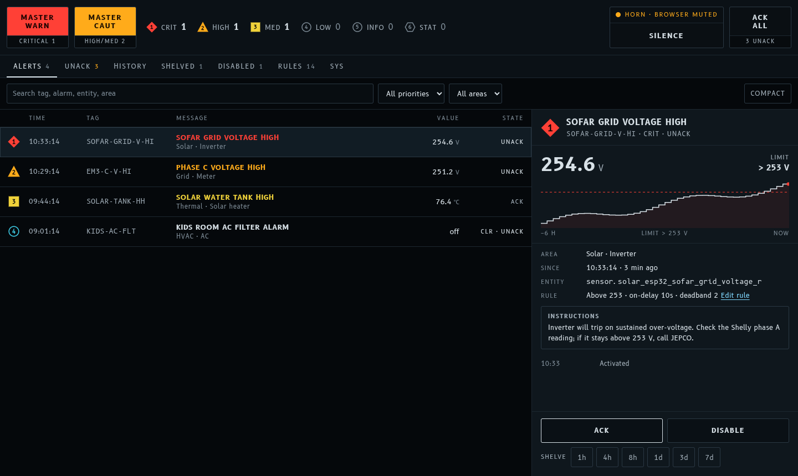
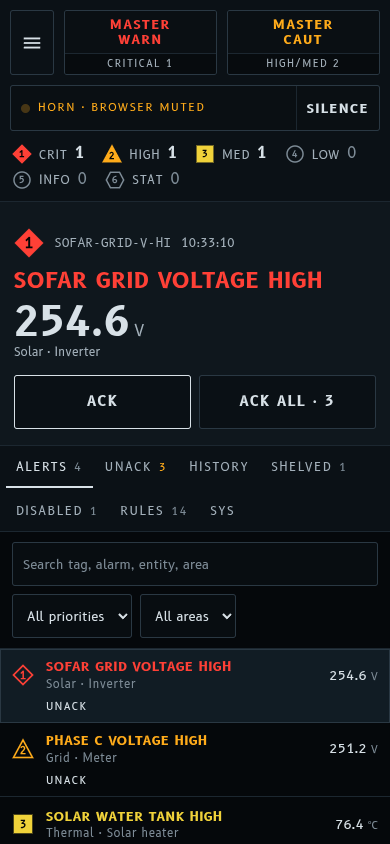

# Industrial Alarm Panel

[](https://www.hacs.xyz/)
[](https://github.com/AlRiachi/industrial-alarm-panel/releases)
[](https://www.home-assistant.io/)
[](LICENSE)

Industrial Alarm Panel is a Home Assistant custom integration that provides a DCS-style alarm annunciator for industrial, energy, and equipment monitoring.

It creates Home Assistant entities, exposes services and a websocket API, persists alarm rules and runtime state, stores alarm history in SQLite, and serves a dedicated sidebar panel at `/industrial-alarms`.





## Highlights

- Dedicated Home Assistant sidebar panel at `/industrial-alarms`, designed like a cockpit alerting display: master WARN/CAUT keys, a priority-ranked alarm stack and a status page per alarm
- ISA-18.2 alarm lifecycle: active, acknowledged, cleared, shelved, disabled
- ISA-101 display rules: colour only for abnormal states, priority shown by shape, number and colour so it reads for colour-blind operators
- Priorities with horn behaviour: `critical`, `high`, `medium`, `low`, `info`, `status`
- Works on a desktop, a phone (one-tap ACK / ACK ALL) and a wall tablet
- Rule editor in the panel: create, edit, clone, enable/disable and delete rules, plus a suggested-rule generator for power, voltage and solar-water sensors
- History with filters and CSV export
- Per-rule binary sensors and operator action buttons, created and removed without reloading the integration
- Rule storage, runtime state persistence and SQLite alarm history with daily retention cleanup
- Browser horn and optional media-player sound output
- HACS-ready repository layout with local Home Assistant brand images

<br clear="right">

## What's New in v1.1.1

- Fixed the phone layout showing "Could not reach the alarm engine: null is not an object (evaluating 'status.previousElementSibling')" after tapping an alarm. The alarm engine was fine: the panel's next refresh removed the unfolded status page, so every later refresh failed until the page was reloaded.

After upgrading, restart Home Assistant. The panel loads the new version on its own.

## What's New in v1.1.0

A redesigned panel and a hardened alarm engine. After upgrading, restart Home Assistant and hard refresh the browser (`Ctrl+Shift+R`).

**New panel**

- New crew-alerting layout: MASTER WARN and MASTER CAUT keys light while alarms of that priority are active and flash while any is unacknowledged. Press one to acknowledge those alarms (MASTER WARN also silences the horn).
- Priority glyphs combine shape, number and colour: ◆1 critical, ▲2 high, ■3 medium, ●4 low, ○5 info, ⬡6 status. The glyph also shows the state: filled = active, hollow = cleared but unacknowledged, struck through = shelved, dashed = disabled.
- Each alarm has a status page: live value, a 6-hour trend against the limit, the rule, instructions, a timeline, ACK, DISABLE/ENABLE, one-tap shelve presets (1 hour to 7 days) and UNSHELVE.
- Phone layout: the top unacknowledged alarm shows first with large ACK and ACK ALL buttons, and tapping a row unfolds its status page in place.
- Rules page: a board with one tile per rule that lights while in alarm, a list view for bulk selection and deletion, and a full rule editor (edit, clone, enable/disable, delete).
- History page: filter by event type, priority and time range, search, and export to CSV.
- SYS page: sound status, TEST HORN, compact rows, flashing on/off, keyboard shortcuts (↑/↓ to move, A to acknowledge, S to silence).
- Only unacknowledged alarms flash (1 Hz). With reduced motion enabled they show a steady marker instead.
- The panel bundles the B612 cockpit typeface (SIL Open Font License), so it works without internet access.
- Faster panel: it no longer redraws everything on each update, the search box keeps focus while alarms update, and the browser horn beeps on a steady interval.

**Engine and security fixes**

- Creating, editing and deleting rules now requires a Home Assistant administrator, in the panel, over the websocket API and through the `create_rule`, `update_rule` and `delete_rule` services. Operators can still acknowledge, shelve and silence.
- Sensor readings that do not change an alarm no longer rewrite the storage file or update every entity. Storage writes are debounced, which saves SD-card wear.
- Shelved alarms now return on time even when their sensor stops reporting.
- A sensor going `unavailable` or `unknown` no longer clears an active above/below alarm.
- Fast-changing attributes are excluded from the recorder database.
- History older than **History retention days** is cleaned up daily. Exports are capped at 10,000 rows.
- Timed silence ends on schedule, **Repeat until silenced** now repeats media-player sound, and flapping alarms that get auto-shelved no longer sound the horn.
- Rules are checked against their sensors' current values at startup, and the horn state survives restarts.
- Adding, editing or deleting a rule no longer reloads the whole integration.
- Clear error messages for invalid rules and unknown alarm IDs.
- New **Media sound URL** option replaces the hard-coded MP3 path (see [Sound](#sound)).
- The options and setup screens now have proper English labels.

## What's New in v1.0.13

- Fixed alarm timing fields so `delay_on_seconds`, `delay_off_seconds`, and `min_active_duration_seconds` now drive the alarm state machine instead of only being stored.
- Added Home Assistant timer scheduling so delayed alarm activations and clears complete even when the source entity does not change again.
- Persisted pending timing state so debounce windows survive Home Assistant storage round-trips.
- Clarified how to use `delay_on_seconds: 5` for alarms that should activate only after the condition lasts longer than 5 seconds.

## What's New in v1.0.12

- Added panel presets for shelving alarms for 1 hour, 4 hours, 8 hours, 1 day, 3 days, or 7 days.
- Added a **Shelved Until** alarm table column so operators can see the current `shelve_expiry`.
- Kept the Home Assistant `shelve_alarm` service duration-based with `duration_minutes`; use `1440` for 1 day, `4320` for 3 days, or `10080` for 7 days.
- Bumped the frontend cache-busting version and package metadata for the new release.

## What's New in v1.0.11

- Added **Select All** and **Deselect All** controls to Suggested Rules previews.
- Added a mobile panel menu button so operators can open the Home Assistant sidebar when edge-swipe is blocked by the panel.
- Preserved horizontal table scroll during alarm, history, rules, and suggested-rule refreshes so wide tables stay on the inspected columns.
- Bumped the frontend cache-busting version and package metadata for the new release.

## What's New in v1.0.9

- Added resizable columns to the alarm, history, rules, and suggested-rule listings.
- Added a 2-second delay before new unacknowledged alarms receive full DCS row coloring, reducing transient visual noise.
- Throttled browser and media-player horn output so repeated Home Assistant refreshes or alarm floods do not stack noisy tones.
- Bumped the frontend cache-busting version and package metadata for the new release.

## What's New in v1.0.8

- Added **Suggested Rules** in the panel Rules tab.
- Suggested rules can create high-consumption, low-voltage, high-voltage, high solar-water temperature, and unavailable-sensor alarms.
- Added full-row DCS-style alarm colors, with acknowledged alarms shown in neutral gray.
- Added event-driven alarm refresh so new alarms appear faster than the polling fallback.
- Fixed Rules tab form inputs being cleared by automatic refresh while an operator is typing.
- Bumped the frontend cache-busting version to force Home Assistant browsers to load the new panel bundle.

## Installation

[](https://my.home-assistant.io/redirect/hacs_repository/?owner=AlRiachi&repository=industrial-alarm-panel&category=integration)

### HACS

1. Add this repository as a HACS custom repository with category `Integration`:

   ```text
   https://github.com/AlRiachi/industrial-alarm-panel
   ```

2. Install **Industrial Alarm Panel** from HACS.
3. Restart Home Assistant.
4. Go to **Settings > Devices & services > Add integration** and search for **Industrial Alarm Panel**.

After upgrading through HACS, restart Home Assistant again. If the sidebar panel was already open, hard refresh the browser with `Ctrl+Shift+R`.

The repository follows HACS integration layout rules: all runtime files are under `custom_components/industrial_alarm_panel`, with a root `hacs.json`, GitHub releases, and one integration directory under `custom_components`.

See [INSTALLATION.md](INSTALLATION.md) for manual installation, media-player sound setup, and a test rule.

## Brand Assets

This repository includes local Home Assistant brand assets in `custom_components/industrial_alarm_panel/brand/`:

- `icon.png` and `dark_icon.png`
- `logo.png` and `dark_logo.png`

Home Assistant 2026.3 and newer can serve local brand assets for custom integrations. Older Home Assistant versions still run the integration, but may not show the local icon/logo in all UI surfaces.

## Entities

Global entities include:

- `sensor.industrial_alarm_panel_active_count`
- `sensor.industrial_alarm_panel_unacknowledged_count`
- `sensor.industrial_alarm_panel_critical_count`
- `sensor.industrial_alarm_panel_high_count`
- `sensor.industrial_alarm_panel_last_alarm`
- `sensor.industrial_alarm_panel_last_event`
- `binary_sensor.industrial_alarm_panel_any_active`
- `binary_sensor.industrial_alarm_panel_any_unacknowledged`
- `binary_sensor.industrial_alarm_panel_horn_active`
- `switch.industrial_alarm_panel_sound_enabled`
- `button.industrial_alarm_panel_acknowledge_all`
- `button.industrial_alarm_panel_silence_horn`
- `button.industrial_alarm_panel_unsilence_horn`
- `button.industrial_alarm_panel_test_sound`
- `select.industrial_alarm_panel_filter_priority`
- `number.industrial_alarm_panel_history_retention_days`

Every stored rule also gets a binary alarm sensor and action buttons. They are created, updated and removed as soon as the rule changes, without reloading the integration.

## Using the Panel

The panel has seven pages: **ALERTS** (active and cleared-unacknowledged alarms), **UNACK**, **HISTORY**, **SHELVED**, **DISABLED**, **RULES** and **SYS**.

- **Master strip:** MASTER WARN (critical) and MASTER CAUT (high and medium) light while alarms of that priority are active and flash while any is unacknowledged. Pressing MASTER WARN acknowledges critical alarms and silences the horn; MASTER CAUT acknowledges high and medium alarms. The horn block shows whether the horn is sounding and has SILENCE. ACK ALL acknowledges everything.
- **Priority key:** ◆1 critical, ▲2 high, ■3 medium, ●4 low, ○5 info, ⬡6 status.
- **State marks:** filled glyph = active, hollow = cleared but not yet acknowledged, struck through = shelved, dashed = disabled.
- **Status page:** select an alarm to see its value, 6-hour trend, rule, instructions and actions. Shelve presets are 1 hour, 4 hours, 8 hours, 1 day, 3 days and 7 days.
- **Phone:** the top unacknowledged alarm is shown first with ACK and ACK ALL, and tapping a row unfolds its status page.
- **Keyboard:** ↑/↓ moves through alarms, A acknowledges the selected alarm, S silences the horn.
- **Browser sound:** browsers only play sound after you interact with the page. Press **ENABLE SOUND** in the horn block (or **TEST HORN** on the SYS page) once on every screen that should sound.

## Rule Creation

Create and manage rules from the panel's **RULES** page, **Developer Tools > Actions**, automations, or scripts. Creating, editing and deleting rules requires a Home Assistant administrator account.

Rules use stable Home Assistant `entity_id` values. For numeric range alarms, create two rules: one `below` rule and one `above` rule.

### Suggested Rules

Open **Industrial Alarms > RULES > SUGGEST RULES** and click **PREVIEW SUGGESTED RULES** to scan current Home Assistant `sensor.*` entities before creating anything. Select the suggestions you want, then click **CREATE SELECTED**. **CREATE ALL** is also available after the preview. Both ask for confirmation and show the estimated Home Assistant entity count.

Default suggested thresholds:

- **High power W**: `2000 W` for power/high-consumption sensors
- **Low voltage V**: `207 V`
- **High voltage V**: `253 V`
- **Solar water °C**: `75 °C` for solar water/tank/boiler temperature sensors

The generator detects candidates from `device_class`, unit of measurement, entity ID, and friendly name. It skips generated rule IDs that already exist so repeated previews or creates do not duplicate rules. Generated suggested rules use IDs beginning with `auto_`.

If too many suggested rules were created, switch the RULES page to **LIST** and use **REMOVE AUTO-GENERATED**. It removes stored `auto_` rules and the per-rule alarm/button entities created by this integration, but it does not remove the original source sensors. For manual cleanup, tick rows in the list and click **DELETE SELECTED**.

### Rule Fields

Common fields:

- `id`: stable rule ID. Keep it lowercase and unique.
- `entity_id`: source entity to monitor.
- `name`: operator-facing alarm name.
- `tag`: short DCS-style tag.
- `area`: room, plant area, or system area.
- `system`: equipment group, such as `SOFAR Inverter`, `Grid`, or `Electric Heater`.
- `condition`: one of `above`, `below`, `equal`, `not_equal`, `contains`, `is_on`, `is_off`, `state_changed`, `unavailable`, `unavailable_for`, `unknown_for`, `manual`.
- `threshold`: numeric value for `above` and `below`, or expected text for text conditions.
- `deadband`: hysteresis for numeric alarms.
- `priority`: `critical`, `high`, `medium`, `low`, `info`, or `status`.
- `instructions`: short operator guidance shown in the panel.

Optional fields include `requires_ack`, `audible`, `delay_on_seconds`, `delay_off_seconds`, `min_active_duration_seconds`, `repeat_alarm_after_seconds`, `show_when_cleared`, and `shelving_allowed`.

Timing fields are in seconds:

- `delay_on_seconds`: the source condition must remain true for this long before the alarm activates. Use `5` for "alarm only if this condition lasts longer than 5 seconds".
- `delay_off_seconds`: the source condition must remain clear for this long before an active alarm clears.
- `min_active_duration_seconds`: once activated, keep the alarm active for at least this long even if the source clears sooner.

### High Temperature Rule

Create a rule from Developer Tools > Services:

```yaml
service: industrial_alarm_panel.create_rule
data:
  rule:
    id: inverter_high_temp
    entity_id: sensor.inverter_temperature
    name: Inverter High Temperature
    tag: INV-TEMP-HH
    area: Solar Inverter
    system: PV
    condition: above
    threshold: 75
    deadband: 2
    priority: critical
    requires_ack: true
    audible: true
    delay_on_seconds: 5
    delay_off_seconds: 10
    instructions: Check inverter ventilation, fans, ambient temperature, and loading.
```

### Voltage Range Rules

```yaml
service: industrial_alarm_panel.create_rule
data:
  rule:
    id: grid_phase_a_voltage_low
    entity_id: sensor.shellyem3_e8db84d68e3c_channel_a_voltage
    name: Grid Phase A Voltage Low
    tag: GRID-A-V-LOW
    area: Electrical
    system: Grid Meter
    condition: below
    threshold: 207
    deadband: 3
    priority: high
    instructions: Check Phase A supply voltage and upstream breaker or utility condition.
```

```yaml
service: industrial_alarm_panel.create_rule
data:
  rule:
    id: grid_phase_a_voltage_high
    entity_id: sensor.shellyem3_e8db84d68e3c_channel_a_voltage
    name: Grid Phase A Voltage High
    tag: GRID-A-V-HIGH
    area: Electrical
    system: Grid Meter
    condition: above
    threshold: 253
    deadband: 3
    priority: high
    instructions: Check Phase A supply voltage and utility condition.
```

### Binary Problem Rule

```yaml
service: industrial_alarm_panel.create_rule
data:
  rule:
    id: electric_heater_overheating
    entity_id: binary_sensor.shellyplus1pm_c4d8d55505a0_switch_0_overheating
    name: Electric Heater Overheating
    tag: EHEATER-OVERTEMP
    area: Electrical
    system: Electric Heater
    condition: is_on
    priority: critical
    instructions: Turn off heater circuit if safe and inspect the load before re-enabling.
```

### Starter Alarm Ideas

Good first rules usually monitor:

- inverter native fault words, for example SOFAR fault registers `> 0`
- grid voltage low/high, for example `< 207 V` and `> 253 V` on 230 V nominal systems
- grid frequency low/high, for example `< 49.5 Hz` and `> 50.5 Hz`
- inverter heatsink or cabinet temperature high
- PV insulation resistance low
- solar heater water temperature high
- built-in problem binary sensors such as overheating, overcurrent, overpower, or overvoltage
- Home Assistant host power problem sensors
- internet connectivity loss if cloud/mobile notification delivery matters

## Services

The integration registers:

- `industrial_alarm_panel.acknowledge_alarm`
- `industrial_alarm_panel.acknowledge_all`
- `industrial_alarm_panel.silence_horn`
- `industrial_alarm_panel.unsilence_horn`
- `industrial_alarm_panel.shelve_alarm`
- `industrial_alarm_panel.unshelve_alarm`
- `industrial_alarm_panel.disable_alarm`
- `industrial_alarm_panel.enable_alarm`
- `industrial_alarm_panel.create_rule`
- `industrial_alarm_panel.update_rule`
- `industrial_alarm_panel.delete_rule`
- `industrial_alarm_panel.test_sound`
- `industrial_alarm_panel.export_history`

`create_rule`, `update_rule` and `delete_rule` require an administrator when called by a user. Automations and scripts can still call them.

Silence only stops horn output. Acknowledgement changes the alarm lifecycle state.
Shelving is temporary and ends on time, even if the source sensor stops reporting. In the panel, press a shelve preset on the alarm's status page. In service calls, set `duration_minutes`; day-based shelves use minute values such as `1440` for 1 day and `10080` for 7 days.

`export_history` returns at most 10,000 rows; pass `limit` to return fewer.

## Sound

Browser sound is generated in the panel with Web Audio after the operator presses **ENABLE SOUND** (or **TEST HORN**). Browsers block audio until you interact with the page, so do this once on each screen that should sound.

Media-player output uses Home Assistant `media_player.play_media`. No audio files are shipped with the integration:

1. Put your own files in `/config/www/` (served as `/local/`), for example `/config/www/alarms/critical.mp3`.
2. In the integration options, set **Media sound URL**, for example `/local/alarms/[priority].mp3`. `[priority]` is replaced by `critical`, `high`, `medium`, `low`, `info` or `status`.
3. Choose the media players under **Selected media players**.

Leave **Media sound URL** empty to use browser sound only. With **Repeat until silenced** on, media players replay the sound every **Repeat interval seconds** until the horn is silenced. A timed silence ends on schedule.

## Storage

Rules are stored in Home Assistant storage with key `industrial_alarm_panel.rules`.
Runtime alarm states are stored with key `industrial_alarm_panel.state`.
History is stored in `/config/industrial_alarm_panel_history.db`. Events older than **History retention days** are deleted once a day. Storage writes are debounced by a few seconds and flushed when Home Assistant stops.

## Troubleshooting

- If `/industrial-alarms` is blank after an update, restart Home Assistant and hard refresh the browser with `Ctrl+Shift+R`.
- If you cannot create, edit or delete rules, sign in with an administrator account. Operators can acknowledge, shelve and silence only.
- If the horn does not play in the browser, press **ENABLE SOUND** in the panel. Browsers block audio until a user gesture.
- If media-player sound does not play, check that **Media sound URL** is set and that the file opens in a browser at that URL.
- Check **Settings > System > Logs** for `industrial_alarm_panel` errors.

## Reporting Issues

Before opening an issue:

1. Update to the latest release.
2. Restart Home Assistant.
3. Reproduce the problem.
4. Check Home Assistant logs for `industrial_alarm_panel`.

Open a GitHub issue here:

```text
https://github.com/AlRiachi/industrial-alarm-panel/issues/new/choose
```

Please include:

- Home Assistant version
- Industrial Alarm Panel version
- install method, usually HACS custom repository
- browser and device if the issue is panel-related
- exact rule YAML or service data if the issue is rule-related
- relevant log lines and screenshots

Security issues should not be reported in public issues. See [SECURITY.md](SECURITY.md).

## Contributing

Pull requests are welcome. Keep changes focused, include tests for behavioral changes, and run:

```bash
python3 -m pytest -q
node --check custom_components/industrial_alarm_panel/frontend/dist/industrial-alarm-panel.js
```

The panel is a single dependency-free custom element in `frontend/dist/` with no build step. Its visual system (tokens, priority glyphs, states) is documented in [DESIGN.md](DESIGN.md), and the product brief is in [PRODUCT.md](PRODUCT.md).

See [CONTRIBUTING.md](CONTRIBUTING.md) for repository workflow and support expectations.

## Development

Runtime dependencies are provided by Home Assistant. The root `requirements.txt` documents that there are no extra runtime Python packages.

Run the pure core tests without Home Assistant installed:

```bash
python3 -m unittest discover -s tests -v
```

For full Home Assistant integration tests, install `requirements_test.txt` in a virtual environment and run pytest.
